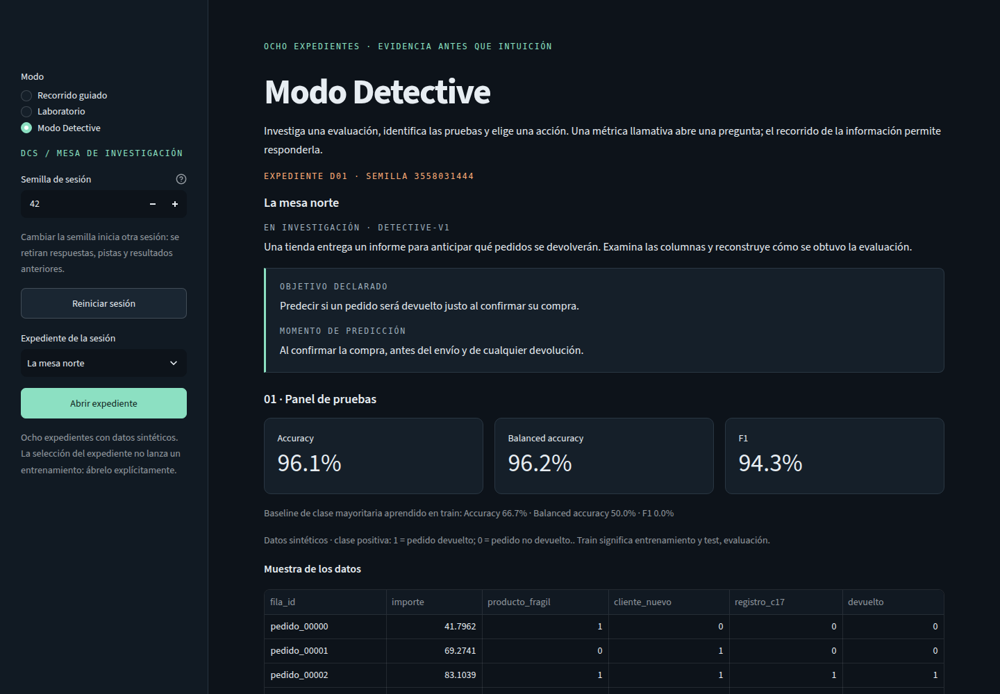
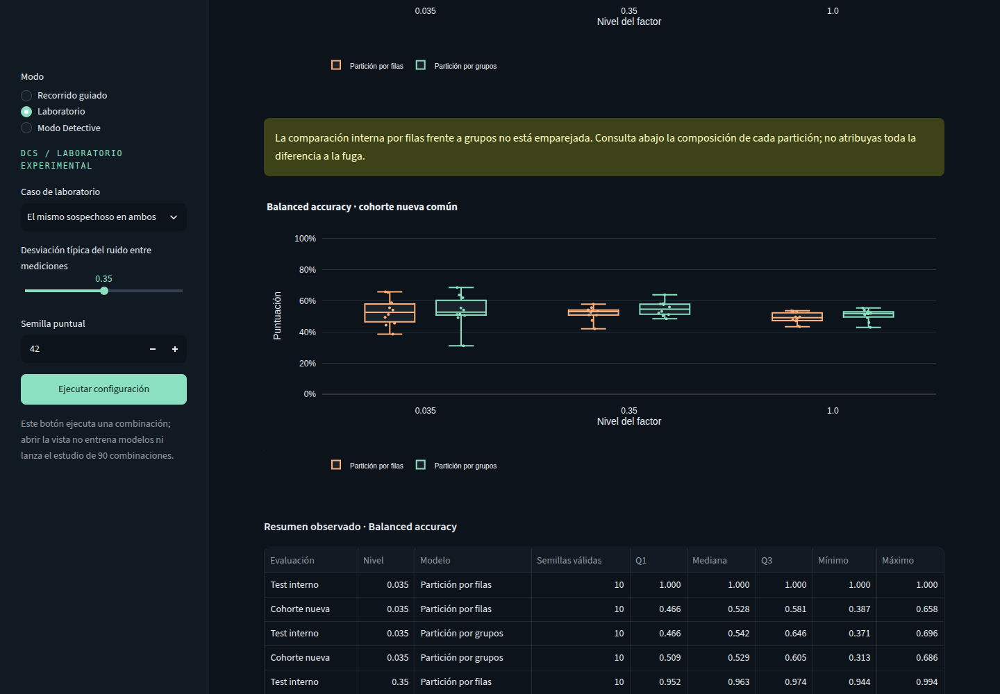

# Data Crime Scene

**El modelo parece funcionar demasiado bien. Investiga si su evaluación es defendible.**

Laboratorio local de machine learning con datos sintéticos, entrenamiento real en CPU e informes reproducibles. Investiga tres mecanismos: información futura, entidades compartidas y selección de variables que consulta test.

| Modo | Qué puedes hacer |
| --- | --- |
| **Modo Detective** | Resolver ocho expedientes: inspeccionar pruebas, pedir información, elegir diagnóstico/evidencia/acción y ejecutar intervenciones. Incluye controles legítimos y expedientes inicialmente incompletos; la solución se revela explícitamente. |
| **Recorrido guiado** | Aprender los tres mecanismos con pistas, código y comparaciones entre procedimientos. |
| **Laboratorio** | Variar un factor, comparar controles y explorar diez semillas por nivel en un estudio descriptivo de 90 combinaciones. |





## Instalar y abrir

Descarga o clona el repositorio y entra en su carpeta. Comandos para Linux/macOS con Python 3.12:

```bash
git clone https://github.com/alvaro-salvador-huertas/data-crime-scene.git
cd data-crime-scene
python3 -m venv .venv
.venv/bin/python -m pip install -r requirements.txt
.venv/bin/python -m streamlit run app.py --server.address 127.0.0.1
```

Abre **http://127.0.0.1:8501** y selecciona **Modo Detective**. Elige un expediente y pulsa **Abrir expediente**. La semilla reproduce el orden y los datos; cambiarla inicia otra sesión. No hay cuentas ni progreso persistente. Detén el servidor con `Ctrl+C`.

La instalación descarga paquetes. En el uso local, después la aplicación funciona sin conexión, sin APIs, credenciales ni recursos cloud; la telemetría de Streamlit está desactivada. Versiones fijadas y comprobadas: Python 3.12.3, NumPy 2.5.4, pandas 3.1.0, scikit-learn 1.9.1, Streamlit 1.66.1 y Plotly 7.1.0.

## Demo pública preparada

La entrada pública reutiliza Guiado, Laboratorio y Detective sin pedir rutas del servidor al visitante. Para probarla localmente:

```bash
.venv/bin/python -m streamlit run demo/streamlit_app.py --server.address 127.0.0.1 --server.port 8502
```

Abrir **http://127.0.0.1:8502**. Esta primera preparación no incluye el estudio agregado; las configuraciones puntuales entrenan y evalúan de verdad. El progreso permanece separado por sesión y no es persistente. En alojamiento, los cálculos ocurren en el servidor y se aplican las condiciones de telemetría del proveedor. Véase [preparación, pruebas y pasos futuros](docs/demo-publica.md). **Preparación comprobada localmente:** 241 pruebas correctas y navegador a 390/1440 px con dos sesiones independientes. **No se ha desplegado la demo en cloud.**

## Comprobar y experimentar

Desde la raíz del proyecto, en otra terminal:

```bash
.venv/bin/python -m pip check
.venv/bin/python -m pytest -q

# Ejecutar los tres casos sin interfaz.
.venv/bin/python -m data_crime_scene --seeds 7 42 2026

# Generar un estudio nuevo; no abrirlo automáticamente al arrancar Streamlit.
.venv/bin/python -m data_crime_scene.study --preflight --output artifacts/preflight-local.json
.venv/bin/python -m data_crime_scene.study --output artifacts/laboratory-study-local.json
```

En Laboratorio, indica `artifacts/laboratory-study-local.json` y pulsa **Cargar estudio local**. Los informes locales se excluyen de Git: una copia recién descargada debe generarlos. La interfaz distingue ejecuciones puntuales de estudios cargados y rechaza configuraciones incompatibles.

La [corrección del baseline de cohorte](docs/correccion-baseline-cohorte.md) exige la clase mayoritaria del entrenamiento de cada variante, incluso si las métricas de un baseline alterado se han recalculado coherentemente. Conserva el empate a 0 y la carga de los informes de la versión histórica revisada, sin modificarlos ni repetir el estudio.

**Verificado en esta corrección:** 226 pruebas aprobadas en 33,36 s en el entorno existente, `pip check` correcto y 21 artefactos históricos intactos. La validación nueva y sus límites están en el [registro de esta corrección](docs/correccion-baseline-cohorte.md). Las comprobaciones históricas fueron [182 pruebas e instalación limpia en Detective](docs/verificaciones-v03.md) y [205 en la integración visual](docs/integracion-visual.md). El [workflow de CI](.github/workflows/ci.yml) ejecuta las comprobaciones en cada publicación; el resultado remoto de cada commit puede consultarse en [GitHub Actions](https://github.com/alvaro-salvador-huertas/data-crime-scene/actions). Las cifras anteriores corresponden a la validación local.

## Qué enseñan los resultados

En el estudio histórico de Laboratorio, el modelo por filas alcanzó una mediana de **100 % de balanced accuracy** en su test interno y **52,8 %** sobre máquinas nuevas con ruido bajo. La selección contaminada alcanzó **79,6 %** con 1800 variables sin señal. Son resultados sintéticos descriptivos, no evidencia de rendimiento en producción ni validación del modo Detective.

Cada punto agregado representa una semilla. Mediana y cuartiles describen esas ejecuciones; no son intervalos de confianza. Las particiones por filas y por entidades cambian la composición evaluada. Una puntuación alta o una caída tras corregir no bastan para validar un experimento.

## Aprender y presentar

- [Modo Detective y reglas de la investigación](docs/modo-detective.md).
- [Metodología](docs/metodologia.md), [protocolo previo](docs/protocolo-laboratorio.md) e [informe crítico del estudio](docs/revision-laboratorio.md).
- [Guía de regreso](docs/guia-de-regreso.md), [preguntas de defensa](docs/defensa-tecnica.md) y [demostración de dos minutos](docs/demo-dos-minutos.md).
- [Contenido preparado para publicación](docs/publicacion.md) y [capturas](docs/screenshots/).

**Licencia:** [MIT](LICENSE), Copyright (c) 2026 Álvaro Salvador Huertas. Las dependencias y recursos ajenos conservan sus [licencias y avisos propios](THIRD_PARTY_NOTICES.md).

El proyecto se desarrolló con asistencia de IA en código, revisión y documentación. Proporciona material para aprender y discutir decisiones de evaluación; no acredita por sí solo dominio profesional de machine learning. La separación entre evidencia y solución evita spoilers accidentales, no pretende ser un sistema antitrampas.

## English summary

Data Crime Scene is an offline machine-learning investigation lab with real CPU training and synthetic data. Detective Mode offers eight evidence-based case files; Guided Mode explains three leakage mechanisms; Laboratory Mode explores controls and variability across predefined seeds. Predictions and JSON reports support reproducibility. Results are educational, not production benchmarks. The UI is primarily Spanish. See the linked methodology and verification notes for limitations and checks actually performed.
