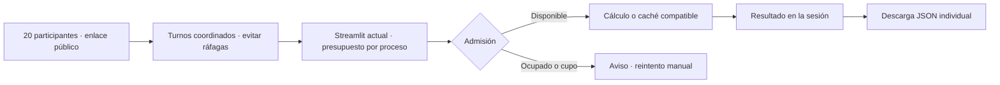

# Capacidad de la demo para un taller

Prueba local del **7 de noviembre de 2026**. Base: `main`, commit `3ce64aa8589211a098343a2c5e3b9080aa80a69d`; checkout limpio al empezar. No había AGENTS.md aplicables; se revisaron README, documentación pública, límites y scripts de navegador.

**Conclusión:** se coordinaron clics de hasta **10 sesiones**, con tres repeticiones por nivel. En cada tanda de 5 o 10, una sesión obtuvo resultado y las restantes fueron rechazadas por cálculo activo. Se abrieron 20 sesiones, pero **no se lanzaron sus experimentos**: el generador de carga superó su umbral conservador de memoria. No hay evidencia de 20 entrenamientos ni de capacidad insuficiente del servidor. Mantendría el despliegue actual para un taller con turnos; no migraría a AWS por estos números. Si aceptar 20 solicitudes simultáneas sin reintento manual es obligatorio, la demo actual no cumple ese contrato y prepararía una cola acotada como trabajo distinto.

## Repetir sin tocar un despliegue

Desde la raíz, en Linux con Python 3.12, Chrome/Chromium y el entorno de navegador ya disponible (`requirements-browser.txt`):

```bash
PYTHONDONTWRITEBYTECODE=1 .venv/bin/python scripts/benchmark_demo.py \
  --output-dir artifacts/capacidad-nueva
```

El script **crea y detiene** su propio servidor público en `http://127.0.0.1:8765`. No hay que arrancarlo aparte. La carpeta de salida debe ser nueva. Opciones principales:

```bash
# Configuración fija; valores predeterminados: 1, 5, 10, 20; tres repeticiones.
.venv/bin/python scripts/benchmark_demo.py --url http://127.0.0.1:8765 \
  --concurrency 1 5 10 20 --repetitions 3 --timeout 45 \
  --budget-seconds 1200 --output-dir artifacts/capacidad-otra

# Complemento sin claves de caché compartidas entre participantes.
.venv/bin/python scripts/benchmark_demo.py --concurrency 1 5 10 \
  --seed-policy distinct --budget-seconds 300 --output-dir artifacts/capacidad-distintas

# Aislamiento y JSON con configuraciones distintas, secuencialmente.
.venv/bin/python scripts/benchmark_demo.py --isolation-only \
  --budget-seconds 120 --output-dir artifacts/capacidad-aislamiento
```

`--case future|groups|selection`, `--seed` y `--download-sample` permiten otros protocolos. La campaña realizada usó **future**, sin modificar sus parámetros; no acredita los otros modos completos. La URL admite únicamente HTTP y 127.0.0.1, sin rutas, credenciales ni parámetros; se comprueba que el puerto no esté ocupado. La navegación bloquea solicitudes HTTP fuera de ese origen. No consulta la demo pública, GitHub ni AWS.

Cada invocación admite como máximo 20 sesiones, tres repeticiones y 1.200 segundos. El timeout por acción fue **45 s**; también hay límites de arranque y de trial. Al agotar el presupuesto se termina el proceso de cálculo antes de limpiar el navegador. Las pruebas que se encadenen deben compartir un presupuesto total de 20 minutos; no hay un contador persistente entre invocaciones.

**Paradas preventivas, sin cambiar protecciones de la demo:** memoria disponible del equipo menor de max(2 GiB, 10 %); memoria de un cgroup acotado por encima del 85 %; RSS sumado de navegador/driver superior a **6 GiB**; errores inesperados, pérdidas, timeouts o verificaciones de descarga fallidas. El umbral se revisa cada 250 ms y antes de liberar las acciones: no es un límite duro de memoria, y la preparación puede superar el umbral antes de detenerse. Un rechazo normal por los límites de la aplicación no detiene por sí solo la escalada.

## Qué se ejecuta y qué se reutiliza

En Guiado, **Ejecutar experimento** entra en `public_action`, retira un resultado anterior y llama a `cached_experiment(case_id, seed, fingerprint)`. En un fallo de caché se ejecuta `run_experiment`: generación, particiones, dos procedimientos y sus baselines. Una llamada al motor es un experimento completo, no necesariamente un único `fit`.

Un rerun vuelve a ejecutar la presentación; no implica otro entrenamiento. El resultado y el revelado se conservan en `st.session_state`. Cambiar caso o semilla invalida el resultado de esa sesión. Guiado cachea hasta 24 claves; Laboratorio hasta 48. La clave incluye configuración y huella del motor. La caché devuelve copias y puede reutilizarse entre sesiones; no contiene las notas ni el progreso de Detective. La documentación oficial describe el [modelo de caché compartida de Streamlit](https://docs.streamlit.io/develop/concepts/architecture/caching).

**Revelar explicación y comparar** habilita la descarga del resultado activo. El JSON procede de `result.to_json()`, incluye caso, semilla, protocolo, filas, etiquetas y predicciones; el botón usa `on_click="ignore"`. La descarga no requiere otro entrenamiento. No se generó el estudio de 90 combinaciones ni se usaron peticiones de salud como experimentos.

### Límites comprobados en código

`ui/public_limits.py` usa un `PublicBudget` compartido por `st.cache_resource`, con bloqueo entre hilos:

- Un cálculo activo por proceso, **sin cola ni reintento automático**. Una solicitud concurrente recibe un aviso y no pasa al motor.
- Hasta 12 admisiones en una ventana móvil de 60 s por proceso. Los errores admitidos también consumen presupuesto. La admisión ocurre antes de consultar la caché: un cache hit tampoco es gratis respecto del cupo.
- Intervalo de 3 s por sesión y notas de hasta 2.000 caracteres.
- La instancia no coordina su presupuesto con otras réplicas. Un proceso nuevo empieza con presupuesto y caché nuevos.

El aviso de cálculo activo se observó realmente. El máximo de 12/minuto y el intervalo individual son **hechos del código y sus pruebas existentes**, no una tasa sostenida validada por esta campaña: ninguna tanda consiguió acercarse a 12 admisiones. Validaciones, renderizado, reruns, conexiones y descargas no están todos dentro del bloqueo; un cálculo activo tampoco equivale a una única hebra nativa ni a un núcleo de CPU.

## Entorno medido

| Elemento | Condición local |
| --- | --- |
| Equipo | Intel Core i7-14650HX; 16 núcleos físicos y 24 CPU lógicas visibles; afinidad 0–23. |
| Sistema | Ubuntu 24.04.5 LTS, Linux 7.0.0-42-generic, x86-64. |
| Memoria | 31,04 GiB totales; 19,02 GiB disponibles al comenzar la campaña principal; mínimo observado en el intento de 20: 16,19 GiB. Swap de 8 GiB, inicialmente sin uso. |
| Cgroups | Ancestros expuestos con `memory.max=max` y `cpu.max=max 100000`; sin cuota finita observada. También se conservan membresía y contadores; no es una máquina aislada de otras aplicaciones. |
| Python | 3.12.3, `.venv` habitual; `pip check` correcto. No se instalaron dependencias. |
| Aplicación | Streamlit 1.66.1; NumPy 2.5.4; pandas 3.1.0; scikit-learn 1.9.1; SciPy 1.18.1; Plotly 7.1.0; Uvicorn 0.54.0; Starlette 1.10.0. |
| Navegador | Playwright 1.64.1, pyee 14.0.0; Chrome 157.0.8103.38 headless. |
| Bibliotecas nativas | OpenBLAS/OpenMP declaran 24 hilos; no se fijaron OMP_NUM_THREADS, OPENBLAS_NUM_THREADS ni MKL_NUM_THREADS. |

**Diferencia respecto de los requisitos actuales:** el entorno reutilizado tiene dateutil **3.0.0**, multipart **0.0.32** y websockets **17.3**, mientras los pins de main son 4.0.0, 0.0.33 y 17.4. No se actualizó la .venv. Los resultados describen este entorno con estas fuentes, no la instalación actual del alojamiento ni una instalación limpia de esos pins. La diferencia queda también en `environment-drift.json`.

## Método

Cada sesión usa un BrowserContext independiente. Todas se preparan antes de liberar una barrera; no hay acciones de entrenamiento durante la preparación. La configuración primaria es **future / semilla 42**: 600 filas, ruido de la variable posterior 0,04, split estratificado 70/30 y StandardScaler + LogisticRegression con C=1, solver liblinear y max_iter=1000, además de baselines. No hay búsqueda de parámetros.

Cada repetición usa un proceso nuevo: caché de resultados y presupuesto empiezan vacíos, conservando sus reglas. **Esto aísla las tandas, no simula un taller continuo y no demuestra recuperación de cuotas bajo carga sostenida.** No se vació la caché del sistema operativo. En 1 usuario se abre además una sesión nueva con la misma clave después de la primera, dentro del mismo proceso, para observar caché caliente.

La campaña complementaria conserva caso y modelo y usa semillas **42…46** con 5 sesiones y **42…51** con 10. No se intentó de nuevo 20. El aislamiento usa future/7 y groups/2026 secuencialmente, conservando ambas sesiones abiertas.

La latencia parte del clic DOM en el navegador y acaba cuando aparecen métricas y la identificación del resultado. Después se verifica la configuración esperada y el fin del rerun. Incluye transporte local, renderizado y espera del observador; no es tiempo puro de entrenamiento. Antes del clic se exige ausencia de métricas: una sesión no puede acreditar un resultado anterior como nuevo. En las acciones correctas se registra si realmente hubo una llamada al motor, separadamente del éxito de interfaz.

Un observador del proceso hijo envuelve **solo durante el benchmark** el gestor original de admisión y la función original del motor. Registra solicitudes, admisiones, rechazos, inicio/fin y duración del motor; no cambia argumentos, límites, relojes, resultados ni archivos de la aplicación. No añade retrasos artificiales. Su escritura de logs añade una pequeña sobrecarga no aislada en un ensayo A/B. El observador importa el motor antes de iniciar Streamlit: desplaza ese coste desde la primera página hacia el arranque. Por eso se hizo también un control de arranque normal sin observador, separado de la prueba de experimentos.

La muestra descarga hasta tres JSON correctos por tanda; al haber solo un éxito por tanda simultánea, se descarga ese. Se exige caso y semilla solicitados, se recalculan accuracy, balanced accuracy, F1 y matriz de confusión desde las predicciones y se contrasta la accuracy visible. El aislamiento verifica que el segundo experimento no altera la configuración ni el resultado de la primera sesión.

## Resultados

Cada mediana y máximo siguiente corresponde **solo a los éxitos**, n=3 por nivel completo. Rechazos, incompletos y fallos no se mezclan en una supuesta latencia de entrenamiento. No se calculan percentiles con esta muestra.

### Configuración fija, caché inicialmente vacía

| Sesiones solicitadas por tanda | Repeticiones | Intentos previstos | Clics confirmados | Éxitos | Límite aplicado | Fallos UI/motor/sesión | Timeouts | Sin lanzar | Mediana / máximo, s |
| --- | --- | --- | --- | --- | --- | --- | --- | --- | --- |
| 1 | 3 | 3 | 3 | 3 | 0 | 0 | 0 | 0 | 0,377 / 0,377 |
| 5 | 3 | 15 | 15 | 3 | 12 | 0 | 0 | 0 | 0,643 / 0,765 |
| 10 | 3 | 30 | 30 | 3 | 27 | 0 | 0 | 0 | 1,638 / 1,925 |
| 20 | 1, detenida | 20 | **0** | 0 | 0 | 0 | 0 | **20** | No medido |

En 5 y 10 se observaron **1 admisión y 1 experimento real por tanda**, con 4 y 9 rechazos respectivamente, todos por cálculo activo. Los clics se distribuyeron en un máximo de **4 ms** con 5 usuarios y **17 ms** con 10. Las otras sesiones no quedaron esperando un trabajo en segundo plano: deben pulsar otra vez. No hubo reutilización de caché dentro de esas tandas frías porque solo una solicitud fue admitida.

Las 20 sesiones sí llegaron a prepararse. Antes de liberar sus acciones, el RSS sumado del cliente alcanzó 8,386 GiB y se aplicó la parada de seguridad. **Son 20 intentos incompletos del benchmark, no 20 errores de la demo ni 20 entrenamientos terminados.** No se repitió ni se elevó el umbral para obtener un número.

### Semillas distintas, sin compartir clave entre participantes

| Sesiones por tanda | Repeticiones | Intentos / clics | Éxitos | Rechazos | Fallos / timeouts | Mediana / máximo, s |
| --- | --- | --- | --- | --- | --- | --- |
| 1 | 3 | 3 / 3 | 3 | 0 | 0 / 0 | 0,391 / 0,393 |
| 5 | 3 | 15 / 15 | 3 | 12 | 0 / 0 | 1,001 / 1,140 |
| 10 | 3 | 30 / 30 | 3 | 27 | 0 / 0 | 1,947 / 2,023 |

También aquí se observó una sola admisión/llamada real por tanda. La dispersión máxima de clics fue 29 ms. Esto confirma el rechazo sin depender de que las semillas coincidieran; no mide diez trabajos aceptados y ejecutados a la vez.

### Arranque, primer resultado, caché y aislamiento

- **Arranque local normal hasta health, sin observador:** 0,374 s, n=1, sin abrir página ni lanzar experimento. El servidor terminó con exit 0; datos en `startup-control.json`. No mide despertar Community Cloud.
- **Arranque instrumentado hasta health:** mediana 1,211 s, máximo 1,233 s, n=10 procesos de la campaña principal. Incluye la precarga del observador; no incluye preparar el navegador y la primera página. No se confunde con el control normal anterior.
- **Primer resultado frío con 1 usuario:** mediana 0,377 s, n=3, después de preparar la página.
- **Nueva sesión con clave ya calculada:** mediana 0,227 s, máximo 0,230 s, n=3; tres admisiones y **cero nuevas llamadas al motor**. Es reutilización, no capacidad adicional de entrenamiento.
- **Aislamiento:** dos sesiones con configuraciones distintas, dos experimentos y dos JSON correctos, sin alteración de la primera al ejecutar la segunda. No es una prueba simultánea de capacidad.
- **Total de comprobaciones de descarga:** 22 JSON verificados entre campañas, piloto y smoke final. Los eventos confirman como máximo una acción admitida activa, incluidos los casos calientes.
- Cronómetros de campañas, checks y control de arranque: aproximadamente **168 s**, incluidos arranques y limpieza, dentro del presupuesto de 20 minutos. Las ventanas con carga son menores; no se usó todo el presupuesto.

Los datos por repetición están en `trials.csv`; cada interacción conserva tiempos, configuración, aviso o error y descarga en `executions.jsonl` y `result.json`.

## CPU y memoria: servidor y generador separados

Se muestreó Linux `/proc` cada **250 ms**. Se reconstruyen descendientes del PID del servidor y, por separado, descendientes del controlador excluyendo el servidor. El segundo grupo contiene Chrome y el driver de Playwright. El controlador Python tiene su propio contador. No se atribuye el consumo de Chrome a Streamlit.

CPU = incremento de tiempo usuario+sistema / tiempo transcurrido; **100 % equivale a una CPU lógica**. Los contadores se leen secuencialmente y los máximos de ventanas breves son aproximados; no son una medida atómica ni permiten afirmar saturación. RSS es la **suma por proceso**, con doble conteo de páginas compartidas: no es PSS ni RAM física exclusiva. Los picos de menos de 250 ms o procesos que mueren entre muestras pueden no capturarse.

| Nivel fijo | Pico RSS servidor, MiB | Pico RSS cliente, GiB | Pico CPU servidor durante acciones | Pico CPU cliente durante acciones |
| --- | --- | --- | --- | --- |
| 1 | 253,7 | 1,766 | 71 % | 172 % |
| 5 | 257,5 | 2,949 | 103 % | 445 % |
| 10 | 261,5 | 4,889 | 106 % | 592 % |
| 20, solo preparación | 254,2 | 8,386 | Sin acciones | Sin acciones |

Los picos RSS incluyen arranque, preparación, acciones y descargas. En el arranque los picos muestreados de CPU del servidor rondaron 1.000 %, separados de las acciones; no deben presentarse como diez entrenamientos simultáneos. El cliente llegó a unos 2.561 % y el controlador a 271 % durante la preparación de 20, con la incertidumbre de muestreo indicada. Las series crudas y los picos por fase se conservan.

El equipo todavía tenía 16,19 GiB disponibles en el intento de 20; no se observó OOM ni un agotamiento físico. **La parada fue una política conservadora del generador basada en RSS, no una demostración de que el portátil o el servidor estuvieran sin memoria.** Compartir equipo con navegador, controlador y otras aplicaciones limita la atribución de las diferencias de latencia. No se deduce una capacidad de producción a partir de estos picos.

## Decisión de despliegue

| Opción | Problema que resuelve | Complejidad añadida | Evidencia y pendiente |
| --- | --- | --- | --- |
| **Mantener el despliegue actual y organizar turnos** — recomendada ahora, condicionada a aceptar turnos | Conserva acceso por enlace y JSON individual. Evita la ráfaga que hoy recibe rechazos. | Coordinación del taller y reintento explícito tras aviso. No ofrece una espera automática ni un SLA. | El límite de admisión explica los rechazos observados. Probar todavía una sesión de taller continua y las versiones/recursos reales del alojamiento. No se ha validado el rendimiento remoto. |
| **Una instancia EC2 para la aplicación** | Da control sobre recursos, entorno y operación si eso se convierte en el problema medido. EC2 permite elegir recursos de cómputo y memoria. | Operación de sistema, exposición HTTPS, actualizaciones, logs, recuperación y gasto; una instancia sigue siendo un punto de fallo. | La prueba no demuestra falta de CPU del servidor. El mismo código conserva un activo y 12 admisiones/minuto: una máquina mayor no elimina esos rechazos. Faltan medición con recursos objetivo, coste y validación operativa. |
| **Interfaz + cola acotada + ejecutor limitado** | Acepta solicitudes para que el usuario espere su turno, en lugar de perder el intento por cálculo activo. Mantiene la URL sencilla. | Identidad y estado de trabajo, límites de cola, resultados temporales por solicitante, sondeo/notificación, expiración, fallos, reintentos y observabilidad. | Justificada como siguiente prototipo **si aceptar los 20 clics es un requisito firme**. Falta medir espera total, aislamiento, recuperación y descarga del mismo resultado; no está implementada ni dimensionada. |

La afirmación sobre EC2 procede de su [documentación oficial de instancias y capacidad configurable](https://docs.aws.amazon.com/AWSEC2/latest/UserGuide/concepts.html). No se propone un tipo ni un precio: el ensayo no permite dimensionarlo. La necesidad operativa y el punto de fallo son inferencias de una arquitectura con un único servidor.

Si se eligiera Amazon SQS para la tercera opción, las [colas estándar pueden entregar un mensaje más de una vez y fuera de orden](https://docs.aws.amazon.com/AWSSimpleQueueService/latest/SQSDeveloperGuide/standard-queues.html). Por tanto, el diseño necesitaría idempotencia por trabajo; no se debe prometer ejecución exactamente una vez. El [visibility timeout](https://docs.aws.amazon.com/AWSSimpleQueueService/latest/SQSDeveloperGuide/sqs-visibility-timeout.html) y la eliminación tras éxito forman parte del control del consumidor. Añadir una cola no sustituye un límite central de trabajo ni crea capacidad de CPU.

La descarga JSON individual es requisito en las tres opciones: el resultado debe corresponder a la configuración del solicitante. Una cola requeriría conservar temporalmente resultado y pertenencia del trabajo para entregarlo a su sesión. **Historial compartido, cuentas/autenticación y persistencia permanente son decisiones separadas del cliente**; no se añaden como requisitos implícitos. El enlace de acceso continúa siendo el objetivo.

### Diagrama de la opción recomendada



**Supuesto de la recomendación:** el cliente acepta coordinar acciones. Como pauta inicial, una solicitud cada 6 s, esperando también a que termine la anterior, deja margen bajo el cupo de 12/minuto; esto es una propuesta organizativa a validar, no un throughput garantizado ni una medición del taller. Veinte solicitudes así requieren del orden de dos minutos. Si el cliente exige que todas se acepten al mismo tiempo sin reintento, esa pauta no satisface el requisito: se pasaría al prototipo de cola y su validación.

## Qué falta y siguiente experimento

**Hechos medidos:** resultados y avisos de las tablas, llamadas reales registradas, caché caliente, JSON, aislamiento de dos sesiones, recursos locales y parada antes de las acciones de 20.

**Inferencias:** el límite de admisión es el primer obstáculo de la ráfaga; cambiar hardware sin cambiar ese comportamiento no la resolvería. El cliente de carga contribuye a la latencia y la memoria observadas. No hay base para justificar una migración de infraestructura por capacidad.

**Supuestos pendientes:** distribución de casos/semillas del taller, cuántas acciones realiza cada persona, aceptación de turnos, condiciones y versiones del alojamiento y expectativa de espera/persistencia. Solo se probaron tandas de Guiado/future y un control groups de aislamiento, no la carga máxima de Laboratorio/selection ni Detective completo.

El siguiente experimento que más reduciría la incertidumbre es **distribuir los 20 clientes entre otro equipo de laboratorio y el actual**, apuntando a una única instancia de prueba local/LAN autorizada, para que el generador no limite el ensayo. Antes se debe usar un entorno temporal con los pins vigentes, sin modificar la .venv habitual. Repetir la misma configuración, conservar admisiones/llamadas al motor, añadir un tramo sostenido de turnos y verificar sus 20 JSON. No basta con 20 health checks ni con bajar las cuotas. Posteriormente, cualquier prueba en el alojamiento real necesitaría su autorización y un alcance propio.

Si aceptar 20 solicitudes es obligatorio, el siguiente experimento de producto sería una cola acotada de un consumidor con espera visible y JSON individual, probando fallos y reintentos. No elegir un servidor por estimación antes de medir ese comportamiento.

## Evidencias, comprobaciones y conservación

Los datos crudos de este ensayo se conservan **solo en la copia local donde se ejecutó**, en `artifacts/capacidad-demo-20261107/`, una carpeta excluida de Git. No está publicada ni es un enlace navegable en GitHub; las tablas de este informe resumen esa evidencia local.

Al repetir el benchmark, `--output-dir artifacts/capacidad-nueva` crea una carpeta nueva **en el ordenador que ejecuta el comando**. Allí se generan `config.json`, `environment.json` y `summary.json`; cada subcarpeta `nNN-rNN/` conserva `result.json`, `executions.jsonl`, `server-events.jsonl`, `resources.jsonl`, el log del servidor y los JSON descargados. Estos archivos no se añaden automáticamente a Git. Una repetición produce mediciones nuevas; no recupera los datos originales ni garantiza los mismos tiempos.

La carpeta original conserva además los auxiliares de análisis de esa campaña. `analysis.py`, `analysis.json`, `levels.csv` y `trials.csv` son archivos locales de aquella intervención: no forman parte de esta PR ni los genera por sí solo el comando del benchmark publicado. Su inventario es:

- Configuración, máquina, versiones y datos por trial; solicitudes/admisiones/motor en `server-events.jsonl`; CPU/RSS por PID en `resources.jsonl`.
- `analysis.json`, `levels.csv`, `trials.csv` y `analysis.py` para recalcular las tablas sin lanzar carga.
- `benchmark-used-for-waves.py`, copia del script utilizado en las tandas. La versión final añade metadatos de fuentes, separa incompletos de fallos y endurece la limpieza al vencer el presupuesto; un smoke posterior confirmó entrenamiento, caché y descarga.
- Intento `pilot`: Chrome bloqueado por el sandbox, sin carga de aplicación. El reintento local autorizado `pilot-local` pasó; una revisión automática de permisos anterior agotó su plazo sin ejecutar comandos.
- Intento `fixed`: comprobación del puerto bloqueada por TIME_WAIT, sin experimento. Se corrigió únicamente el benchmark con SO_REUSEADDR; `fixed-v2` conserva toda la escalada posterior.
- `deadline-check`: prueba deliberada de presupuesto de 2 s, sin clic ni llamada al motor, proceso detenido con SIGKILL y parcial guardado. No se cuenta como fallo de capacidad ni timeout de un experimento.
- En el cierre inicial de la campaña, 13 pruebas enfocadas aprobadas: validación del destino, JSON/configuración, métricas, clasificación de límites/caché/incompletos y separación de árboles de procesos.
- Revisión independiente de las trazas: como máximo una admisión activa, 22 descargas válidas y ningún PID propio de servidor o navegador todavía vivo.

El presupuesto no se agotó en la campaña de capacidad; su parada fue la protección del generador al preparar 20. No hubo errores del motor, pérdidas de sesión ni timeouts de acción en las tandas ejecutadas. No se encontró un defecto nuevo de la demo en ese alcance; el rechazo sin cola es su comportamiento actual documentado, no una excepción del motor.

### Corrección posterior del registro parcial

La versión publicada registra cada sesión antes de lanzar la tanda y la actualiza conforme avanza. Si el presupuesto cancela `asyncio.gather`, conserva el resultado terminado, el clic confirmado pendiente o la acción sin confirmar. Un clic desconocido queda como `clicked: null`; no se convierte en «no hubo clic». El registro parcial también permanece en el resumen de campaña y en la comprobación de caché caliente. La cancelación sigue propagándose y la limpieza sigue deteniendo el servidor y cerrando contextos, monitor y log.

Las pruebas enfocadas actuales son **17**. Incluyen una cancelación con una sesión terminada y otra con clic confirmado, una acción sin confirmar y la comprobación de caché interrumpida; las entradas/salidas del servidor y navegador se simulan, sin lanzar carga. Esta corrección no repite la campaña, no reescribe sus datos y no cambia sus conclusiones ni las diferencias de versiones documentadas.

Se conservaron los bytes anteriores del motor, aplicación, .venv e históricos y no se regeneraron estudios. No se modificaron portfolio, dependencias de producción ni despliegues. La campaña se realizó localmente; esta PR publica únicamente el benchmark, sus pruebas, el informe y el [guion de entrevista](entrevista-capacidad-demo.md), sin datos crudos, registros ni archivos de entorno.
